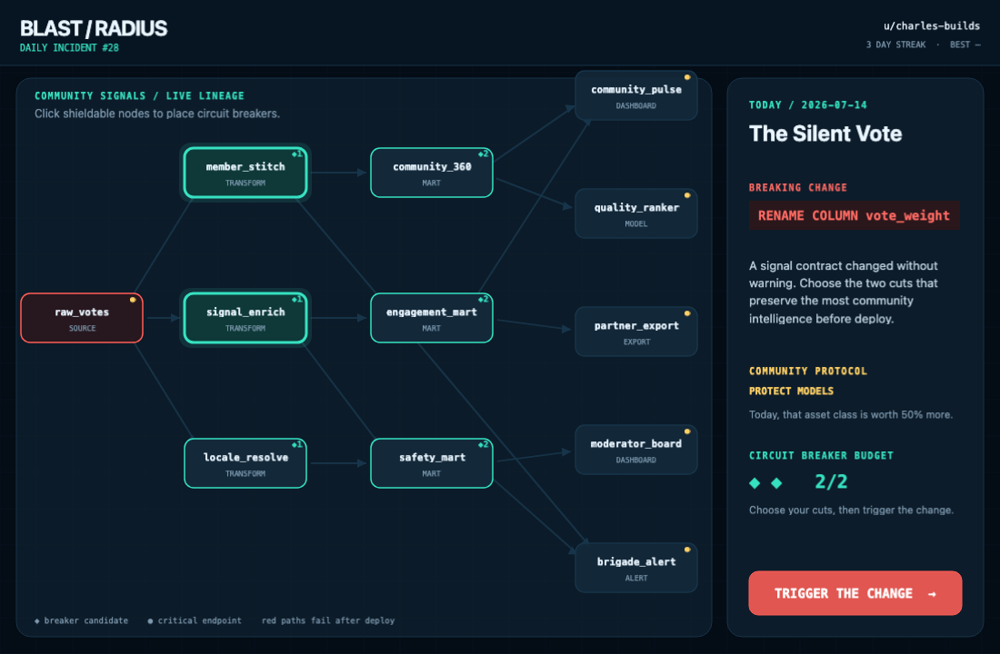
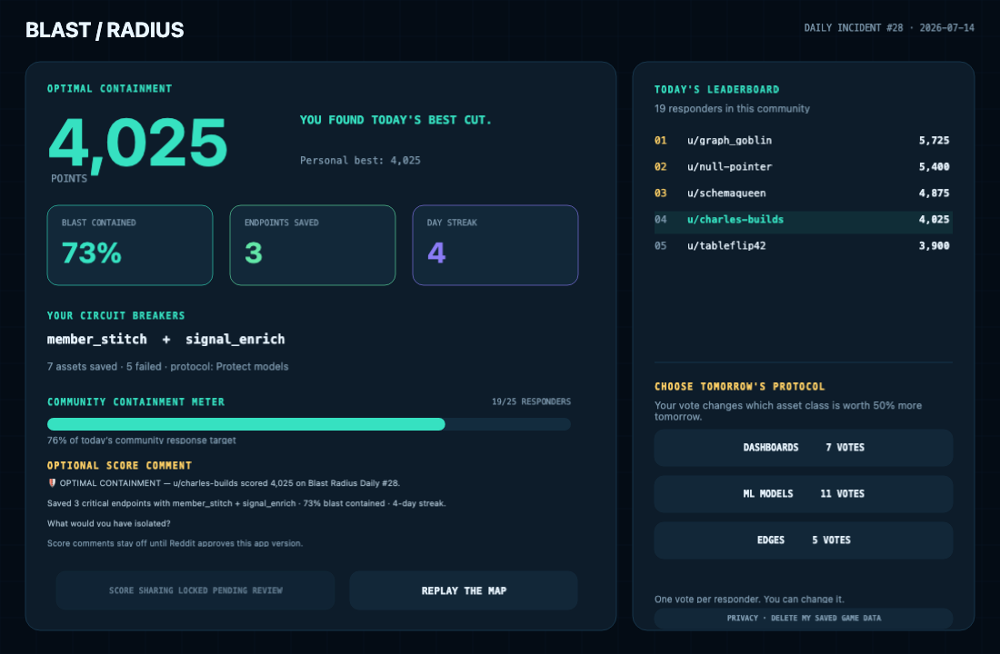

# Blast Radius Daily

[](https://github.com/ult666666/blast-radius-daily/actions/workflows/ci.yml)

Blast Radius Daily is a one-minute community puzzle that turns data lineage into a dramatic daily incident. Everyone in a subreddit receives the same dependency map and the same breaking schema change. Players spend two circuit-breaker tokens, trigger the deploy, and watch the failure cascade through the graph. The goal is to preserve the highest-value dashboards, models, alerts, and exports.



The game is designed for Reddit communities that enjoy engineering, systems thinking, optimization, or daily collaborative challenges. It is immediately playable from a Reddit post and optimized for desktop and landscape-tablet play. The current 1100×720 board is not presented as a narrow portrait-phone experience. The game does not require an external account, external server, payment, or API key.



Every completed run contributes to a subreddit-wide containment meter and a daily leaderboard. A streak rewards returning players. After playing, each responder can vote for tomorrow's community protocol; the winning protocol makes dashboards, models, or external-edge assets 50% more valuable in the next puzzle. The app also contains a fail-closed score-comment flow, but it stays disabled until Reddit approves user-action permissions for the current version and the developer explicitly enables it. When enabled, it requires a verified sticky command comment and posts only the exact one-time server draft shown to the player.

Important operational notes:

- Daily puzzles are deterministic and reset at 00:00 UTC.
- Scores and protocol votes live only in Reddit Devvit Redis, namespaced to the subreddit installation.
- The server recalculates every submitted result; the client cannot submit an arbitrary score.
- The app makes no external HTTP requests and does not use advertising, payments, tracking pixels, generative AI, or third-party data.
- Score sharing is off by default. If Reddit approves it and the developer enables it, sharing remains optional, separate from gameplay, bound to the exact visible draft, and limited to one attempt per player per day.

## How to play

1. Open the Blast Radius Daily post and select **Enter incident**.
2. Read the breaking change and today's community protocol.
3. Tap or click a node marked with `◆` to place a circuit breaker. The small number beside the symbol is its token cost.
4. Spend no more than two tokens. You may remove and replace breakers before deploying.
5. Select **Trigger the change**.
6. Watch the red failure pulses move through unprotected lineage paths. Saved assets turn green.
7. Review the score, daily rank, saved critical endpoints, and community containment meter.
8. Optionally vote for tomorrow's protocol.
9. If score sharing has been approved and enabled, optionally select **Post score as u/yourname**. The full comment is visible before that separate button. Playing, scoring, and voting never require a comment.
10. Use the two-step **Delete my saved game data** privacy control at any time to remove your score, responder state, vote, streak, and pending share draft from app storage.

There may be more than one optimal cut. The server awards a 1,000-point optimization bonus whenever a selection reaches the best score possible for that day's graph and protocol.

## Community features

- **Shared daily map:** every player in the subreddit solves the same incident.
- **Daily leaderboard:** the eight highest validated scores are shown in rank order.
- **Return streak:** consecutive UTC-day participation builds a visible streak.
- **Containment meter:** unique daily responders collectively fill a 25-player goal.
- **Tomorrow protocol vote:** responders choose which asset class receives extra weight in the next puzzle.
- **Review-gated incident comment:** after Reddit approval only, an explicit optional action can reply once to a verified sticky command comment with the exact previewed score summary.

## Moderator setup

Requirements: a Reddit account connected to Devvit, a test or destination subreddit you moderate, and Node.js 22.2 or newer.

1. Create or select a Devvit app at <https://developers.reddit.com/new> using the Phaser template.
2. Make sure the registered app name matches the `name` in `devvit.json`. This build uses the unique slug `blast-radius-daily`.
3. Install dependencies with `npm install`.
4. Sign in with `npm run login`.
5. Set the test subreddit when prompted, or run with `DEVVIT_SUBREDDIT=your_test_subreddit npm run dev`.
6. Playtest on desktop and a landscape touch viewport. Installation creates the first daily post automatically. Narrow portrait phones are outside this version's stated support.
7. Moderators can create another daily post from **Create today's Blast Radius post** in the subreddit menu.
8. Upload a private build with `npm run deploy`.
9. Keep the global `score_sharing_approved` setting off during playtest and review. Enable it only after Reddit approves `SUBMIT_COMMENT` for the installed version.
10. When the app and README are final, submit it for Reddit review with `npm run launch`.

The menu action and installation trigger create a custom post plus a command comment. Score sharing is available only when the app verifies that comment is sticky at creation and again immediately before posting; otherwise the share control is disabled.

## Developer setup and verification

```bash
npm install
npm run verify
```

`npm run verify` performs strict TypeScript checking, ESLint, deterministic engine tests, and a production Devvit/Vite build. CI runs the same steps on Node 22 and 24 for every pull request and push to `main`.

For a visual-only local demo that uses fake community data and never contacts Reddit:

```bash
npm run preview:local
```

Then open:

```text
http://127.0.0.1:5173/src/client/game.html?demo=1&day=2026-07-14
```

The full server workflow must be tested through `devvit playtest`, because Reddit context, Redis, and user actions are only available inside Devvit.

## Architecture

```text
Reddit custom post
  ├─ Inline HTML launch screen
  └─ Expanded Phaser 4 game
       │
       ├─ GET  /api/session  ── daily puzzle, rank, streak, community state
       ├─ POST /api/score    ── server recomputes cascade and score
       ├─ POST /api/vote     ── structured vote for tomorrow's protocol
       ├─ POST /api/share    ── review-gated, exact-draft score comment
       └─ DELETE /api/data   ── immediate deletion of the player's app data
                                │
Devvit Web server (Hono) ───────┴─ Devvit Redis + Reddit API
```

The puzzle engine in `src/shared/game.ts` is deterministic and shared by the Phaser client and server. The server never accepts a client-provided numeric score.

## Data, privacy, and safety

Blast Radius Daily stores only the minimum data required for its game mechanics:

- Reddit username, validated score, and daily responder state: daily keys expire 8 days after their final update (less than 9 days from the earliest activity in that UTC day).
- Structured protocol vote: the same daily-key window, always under 9 days.
- Last-played day and streak count: up to 30 days.
- A pending exact-text share draft: the same daily-key window and deleted after use.
- Native score comment: only when the feature is approved and enabled and the player presses the explicitly labeled post button; the comment follows normal Reddit deletion and reporting controls.

All game state is stored inside the subreddit installation's Devvit Redis namespace. Nothing is sent to an external service. The app does not read private messages, browsing history, email addresses, precise location, or content from other posts and comments. It does not permit free-form in-app content, so protocol contributions are limited to three safe predefined choices. Expiring keys remove account-linked state within 30 days, while the result screen provides an immediate two-step deletion control. Post and command-comment deletion triggers remove their stored routing metadata.

Devvit Web 0.13.7 does not expose an `AccountDelete` trigger in `devvit.json`, so the app cannot receive an immediate platform event when a Reddit account itself is deleted. Until that capability exists, the build minimizes retention, provides immediate user-initiated deletion, and does not claim event-driven account-deletion handling.

## Accessibility and device support

- High-contrast status colors are paired with text and symbols rather than used alone.
- Interactive nodes and buttons are designed for mouse input and landscape touch layouts.
- The Phaser canvas preserves a stable 1100×720 composition and scales to desktop or landscape-tablet expanded views.
- The inline launch screen has a separate mobile layout and does not trap feed scrolling.
- Animations communicate state but scoring does not depend on reaction speed.
- Narrow portrait-phone gameplay is a documented limitation of this version rather than an unsupported responsiveness claim.

## Support

For app issues, contact Charles Dai at `charles@madebymotionx.com` or open an issue in the public project repository once published.

## Credits and license

Built with the official Reddit Devvit Phaser starter, Phaser 4, Vite, Hono, and TypeScript. All game design, copy, visual treatment, graphs, and puzzle data in this repository are original and programmatically rendered. The code is available under the BSD 3-Clause license in `LICENSE`.
