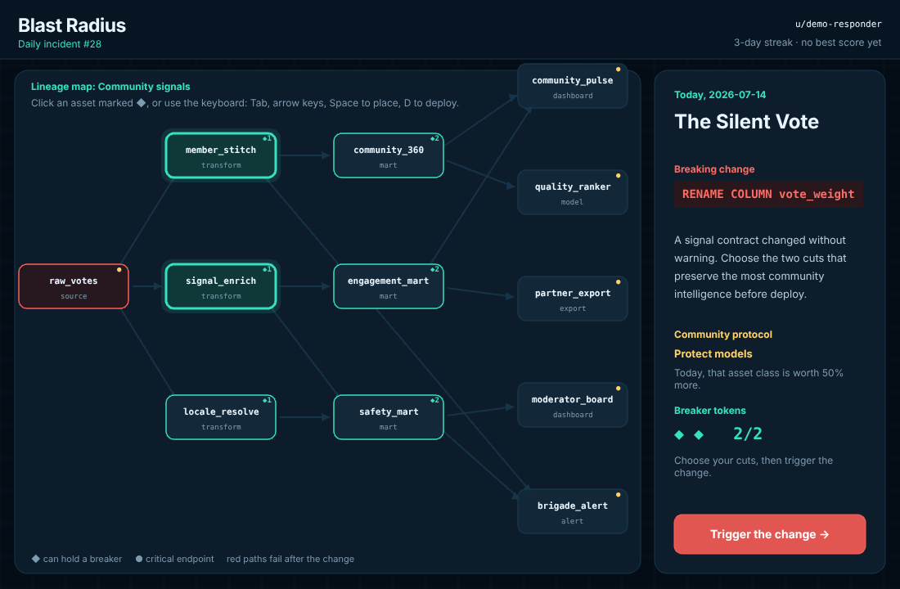
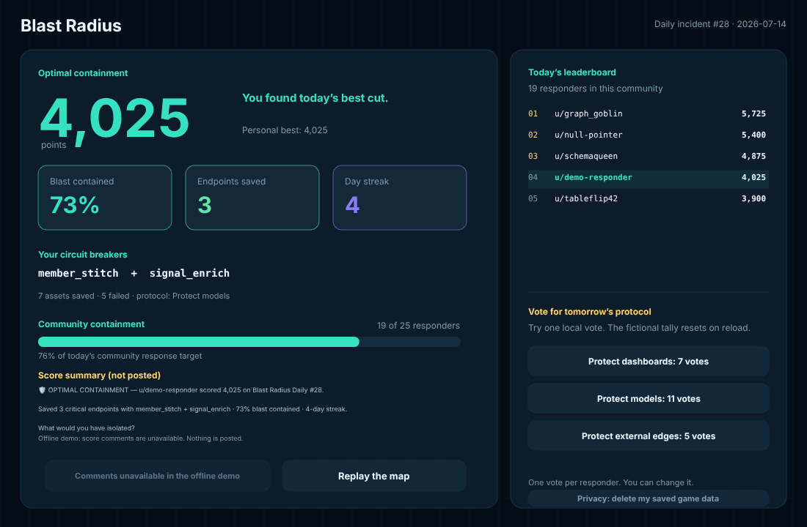

# Blast Radius Daily

[](https://github.com/ult666666/blast-radius-daily/actions/workflows/ci.yml)

A one-minute daily puzzle about data lineage, built as a Reddit app with Devvit and Phaser.
Everyone in a subreddit gets the same dependency map and the same breaking schema change. You
spend two tokens on circuit breakers, trigger the change and watch the failure spread through
the graph; the goal is to save the most valuable dashboards, models, alerts and exports.

**[Play the offline demo](https://ult666666.github.io/projects/blast-radius-demo.html)** in a
desktop browser. It runs the same puzzle engine with sample community data and needs no Reddit
account. No public Reddit post is linked yet.



## How to play

1. Open the Blast Radius Daily post and select **Play today's incident**.
2. Read the breaking change and today's community protocol.
3. Click or tap an asset marked `◆` to place a circuit breaker; the number next to `◆` is its
   token cost. With a keyboard, Tab to the map, move with the arrow keys and press Space or
   Enter to place or remove a breaker.
4. Spend up to two tokens. You can remove and move breakers before you deploy.
5. Select **Trigger the change**, or press D on the map. Red pulses show the failure spreading
   through unprotected paths, and saved assets turn green.
6. Review your score, your daily rank, the critical endpoints you saved and the community
   meter. You can then vote for tomorrow's protocol.

A day can have more than one best cut. Any selection that reaches the best possible score for
that day's map and protocol earns a 1,000-point bonus.



## What it does

- Everyone in a subreddit solves the same map. Puzzles are deterministic and reset at 00:00 UTC.
- The server recomputes every result from the selected breakers, so a client cannot submit a
  score of its own.
- A daily leaderboard shows the eight highest scores, and consecutive days build a streak.
- A containment meter fills toward a goal of 25 players each day.
- Players vote for tomorrow's protocol: the winning asset class (dashboards, models or external
  edges) is worth 50% more in the next puzzle.
- After a game, a player can post a score comment, but only once Reddit approves the permission
  and the developer turns it on. The comment shows in full before the separate post button, it
  replies to the post's pinned command comment, and each player can post once a day.
- A two-step **Delete my saved game data** control removes the player's score, responder state,
  vote, streak and pending comment draft at any time.

The app makes no external HTTP requests and has no ads, payments, tracking pixels, generative AI
or third-party data.

## Accessibility

The whole game works from the keyboard. Tab reaches the map as one stop; Up and Down move
through the assets in reading order, Left and Right jump to the next column, and Home and End go
to the first and last asset. Space or Enter places or removes a breaker, D triggers the change,
and Tab moves on to the Trigger button and out of the game, so focus is never trapped. A white
ring with a dark edge shows the focused asset on the canvas.

For screen readers, a visually hidden list mirrors the canvas: each asset with its type, value,
dependencies, breaker cost and, after the change, whether it failed or was saved. A polite live
region announces each breaker, the tokens left, the cascade result and the score. The result
screen mirrors the score, the leaderboard and every button. With reduced motion requested, the
cascade appears at once, and the pulses, camera shake, fades and hover scaling are off. Status
colors always come with text or symbols, and scoring never depends on reaction speed. The launch
screen in the feed has its own mobile layout and does not trap scrolling.

[docs/OFFLINE_DEMO.md](docs/OFFLINE_DEMO.md) describes keyboard play and the tests that check it.

## Data and privacy

The game stores only what its mechanics need, all in the subreddit installation's Devvit Redis
namespace:

| Data | Kept for |
| --- | --- |
| Reddit username, validated score and daily responder state | 8 days after the day's last update (under 9 days from that day's first activity) |
| Protocol vote | The same daily window |
| Last day played and streak | Up to 30 days |
| A pending score-comment draft | The same daily window, and deleted once used |
| A posted score comment | Normal Reddit comment deletion and reporting rules |

Nothing is sent to an external service. The app does not read private messages, browsing
history, email addresses, precise location or other posts and comments. Players cannot enter
free text; votes are three fixed choices. Deleting the post or its command comment removes the
routing data stored for them.

The score comment stays disabled until Reddit approves the user-action permission for the
installed version and the developer enables it. When enabled, the app checks that its command
comment is pinned when the post is created and again right before posting, and it posts only the
exact one-time draft the player saw.

Devvit Web 0.15.1 has no `AccountDelete` trigger, so the app cannot react when a Reddit account
is deleted. It relies on short retention and the in-game deletion control instead.

## Moderator setup

You need a Reddit account connected to Devvit, a test or destination subreddit you moderate, and
Node.js 22.12 or newer (the Vite 8 floor).

1. Create or select a Devvit app at <https://developers.reddit.com/new> using the Phaser template.
2. Make sure the registered app name matches `name` in `devvit.json`. This build uses the slug
   `blast-radius-daily`.
3. Install dependencies with `npm ci`.
4. Sign in with `npm run login`.
5. Set the test subreddit when prompted, or run `DEVVIT_SUBREDDIT=your_test_subreddit npm run dev`.
6. Playtest on a desktop and on a landscape touch screen. Installing the app creates the first
   daily post.
7. Moderators can create another daily post with **Create today's Blast Radius post** in the
   subreddit menu.
8. Upload a private build with `npm run deploy`.
9. Keep the global `score_sharing_approved` setting off during playtest and review. Turn it on
   only after Reddit approves `SUBMIT_COMMENT` for the installed version.
10. When the app and README are final, submit it for Reddit review with `npm run launch`.

The menu action and the install trigger create a custom post and a command comment. The full
server workflow can only be tested with `devvit playtest`, because Reddit context, Redis and user
actions exist only inside Devvit.

## Development

```bash
npm ci
npm run verify
```

`npm run verify` runs strict TypeScript checking, ESLint, the engine and demo-state tests, the
production Devvit build and the offline build. CI runs it on Node 22 and 24, and a separate job
plays the offline game in Chromium.

To build and play the offline demo without Reddit or a server:

```bash
npm ci --ignore-scripts
npm run build:demo
npx playwright install chromium --only-shell
npm run test:demo
```

`dist-demo/blast-radius-demo.html` is a single file with its code, styles and license notices,
so it also works offline from disk. It starts on the July 14, 2026 puzzle, and the date picker
loads any other day. `npm run test:demo` plays it in Chromium by mouse and by keyboard and scans
it with axe-core; [docs/OFFLINE_DEMO.md](docs/OFFLINE_DEMO.md) lists each journey.

For a live development preview, run `npm run preview:local` and open
`http://127.0.0.1:4174/src/client/game.html?demo=1&day=2026-07-14`.

```text
Reddit custom post
  ├─ Inline HTML launch screen
  └─ Expanded Phaser 4 game
       │
       ├─ GET  /api/session  ── daily puzzle, rank, streak, community state
       ├─ POST /api/score    ── server recomputes cascade and score
       ├─ POST /api/vote     ── structured vote for tomorrow's protocol
       ├─ POST /api/share    ── review-gated, exact-draft score comment
       └─ DELETE /api/data   ── immediate deletion of the player's app data
                                │
Devvit Web server (Hono) ───────┴─ Devvit Redis + Reddit API
```

The puzzle engine in `src/shared/game.ts` is deterministic and shared by the Phaser client and
the server.

## Limits

- The 1100×720 board is built for desktop and landscape tablets; narrow portrait phones are not
  supported.
- Keyboard and screen-reader play is tested in Chromium with Playwright and axe-core, not with a
  physical screen reader such as NVDA, JAWS or VoiceOver, and not inside Reddit's apps.
- The Devvit game page keeps its `user-scalable=no` viewport, so the tests skip axe's
  `meta-viewport` rule on that page only; desktop browser zoom still works.
- The offline demo does not cover Reddit installation, Redis storage, live community activity or
  score comments.

## Support

For app issues, contact Charles Dai at `charles@madebymotionx.com` or
[open an issue](https://github.com/ult666666/blast-radius-daily/issues).

## Credits and license

Built with the official Reddit Devvit Phaser starter, Phaser 4, Vite, Hono and TypeScript. The
game design, copy, visual treatment, graphs and puzzle data in this repository are original and
drawn in code. Built with AI coding assistants; I reviewed the code and the tests that check it.

The code is available under the BSD 3-Clause license in [`LICENSE`](LICENSE).
